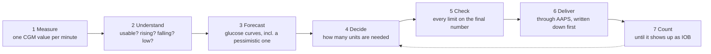
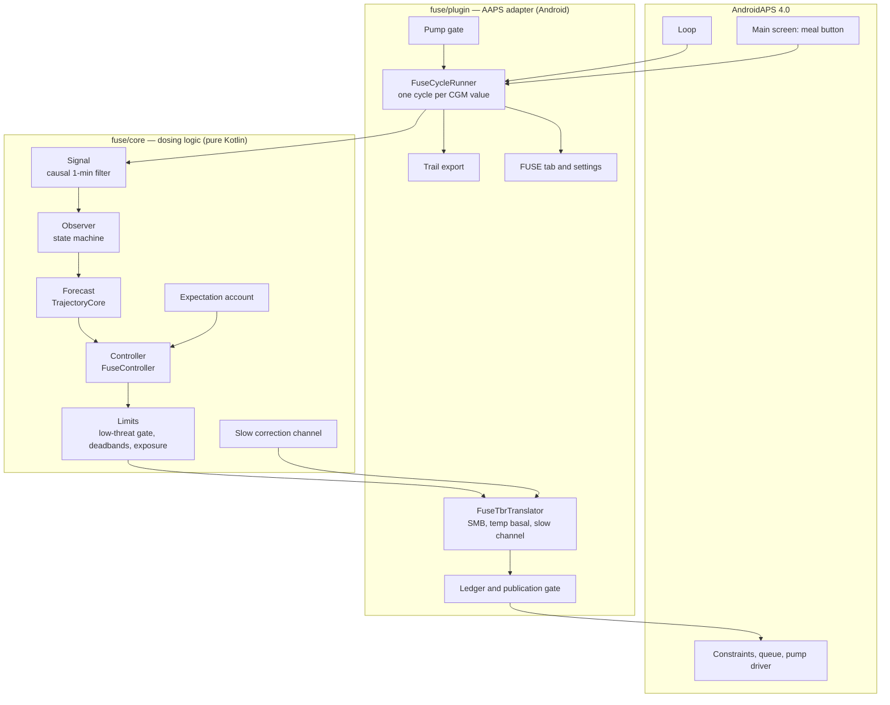

# FUSE 2 for AndroidAPS 4.0

**FUSE** — *Full-loop Unannounced-disturbance Safety & Exposure Controller* — is an insulin-dosing algorithm that runs as an
APS plugin inside [AndroidAPS](https://github.com/nightscout/AndroidAPS) (AAPS). This branch, `4.0.0.0+fuse2.0.0-toni`,
is FUSE 2 on top of AAPS 4.0.

> [!CAUTION]
> **Personal research software. Not a supported AAPS variant, not a release, not a medical device.**
>
> FUSE has controlled a real insulin pump since 15.08.2026 — for **one person (its author)**, on **one pump model**
> (Medtrum Nano), with **one CGM**. There is no second user, no independent review and no clinical evaluation.
> "In daily use" describes risk exposure, not maturity.
>
> Do not build, install or use this to make treatment decisions unless you own this fork, understand the code and accept
> the risk. Every pump model that is not explicitly allowed in the source is blocked.

**Deutsch:** Eine Kurzfassung auf Deutsch steht [am Ende dieser Seite](#deutsche-kurzfassung).

---

## FUSE in one minute

- **What it is.** FUSE replaces the dosing algorithm in AAPS — the part that normally runs OpenAPS SMB or autoISF. AAPS
  still owns the pump, the CGM, the command queue and its own safety constraints.
- **What it decides.** Every minute FUSE decides **how many units** of insulin to give — as a small bolus (SMB) or with a
  temporary basal rate. It does not tune a sensitivity factor and let a dose fall out of it.
- **What it counts.** FUSE keeps its own books. Every unit it asked for is counted until AAPS shows it as insulin on board
  (IOB). Insulin that is still on its way already counts against the next decision.
- **What it needs.** A CGM value **every minute**. The whole design is built on one-minute steps.
- **What it does not need.** No carb entries and no meal bolus. For meals there is one button that says *"a meal is
  starting"* — not how big it is.
- **How it fails.** When an input is missing or unclear, FUSE gives **no new insulin** and the profile basal keeps
  running. Missing information never becomes permission.

## What the name means

| Letter | Word | Meaning |
|---|---|---|
| F | **Full-loop** | Meals do not have to be announced with carbs or a bolus. |
| U | **Unannounced disturbance** | FUSE estimates one number: how fast *something other than the known insulin* pushes glucose up or down — a meal, stress, an infection, a bad infusion site or sensor drift. It does not try to name the cause. |
| S | **Safety** | Signal checks, a pessimistic forecast, deadbands and a pump allowlist are hard rules, not hints. |
| E | **Exposure** | Every decision is limited and booked in insulin units — from the proposal to the pump and back. |
| — | **Controller** | FUSE produces the real AAPS dosing result. It is not a viewer and not a shadow model. |

The everyday word fits too: FUSE *fuses* signal, profile, insulin action and the meal button into one decision — and,
like an electrical fuse, it cuts off when a safety condition cannot be shown.

## One cycle, step by step

1. **Measure.** FUSE reads the CGM value and smooths it with a *causal* filter — it uses only past values, so it could
   run in real time. Gaps, stale values and sensor jumps are named states. They never turn into a harmless-looking number.
2. **Understand.** A small state machine tracks whether glucose is quiet, rising, turning or low. The quality of the
   input is tracked separately, so "rising" and "bad input" can never hide each other.
3. **Forecast.** FUSE predicts glucose minute by minute, from the profile, the insulin on board and the estimated
   disturbance. There is always a *pessimistic* curve, and **every safety check reads the pessimistic curve**.
4. **Decide.** From the forecast FUSE computes the remaining need in units ("demand").
5. **Check.** The amount must pass every limit that applies (see [Safety](#safety-the-rules-that-always-apply)). The
   limit that actually cut the amount is saved by name.
6. **Deliver.** FUSE hands a normal AAPS result to the loop. The amount is written to FUSE's own ledger **before** it
   leaves.
7. **Count.** Until AAPS shows the delivery as IOB, the amount stays on FUSE's books.

A later step may only make the amount **smaller**, never larger. The few documented exceptions need an explicit human
statement (the meal button) or demand that is already proven — and they are still bound by the final limits.

## How FUSE gives insulin

| Way | What it does | Default |
|---|---|---|
| **SMB** (fast) | Small boluses, at most one per minute, sized to the remaining need. The main way FUSE corrects. | on (follows the AAPS SMB switch) |
| **Profile basal** | Always runs, unless FUSE has a protective reason to stop it. | on |
| **Protective zero** | A zero temp basal — only when glucose is measured low, or falling while more bolus insulin is on board than the distance to the safety floor needs. When the reason is gone, FUSE returns to profile basal. | on |
| **Slow correction channel** | A **positive** temp basal, like the high temp in autoISF: basal + 2 × remaining need, in 30-minute blocks, in steps of 0.25 × profile basal, up to *factor × profile basal* (factor 1.2–5; optional own, smaller factor at night with its own hours, factory 22:00–06:00). It runs next to SMBs and may continue when the guard or other model limits block SMBs — so a real need is not left without insulin. maxIOB limits SMB and temp basal together. It stops on a clear fall, below *threshold − 20 mg/dl*, on a protective zero and inside the night or rebound deadband. | off (switch) |
| **Liveness channel** | Makes demand that the main path already sees deliverable in small steps when the pessimistic checks starve it. Merged as `max(normal, liveness)`, never added. | off (switch) |
| **Onset channel** | An early, limited response at the start of a rise that nobody announced (envelope 1.5 U). Off while a meal account runs. | on |
| **Zero latch / partial basal** | Hold a protective zero through a fall, then return to profile basal in partial steps. | off (switches) |

## Meals: one button

The meal button sits on the AAPS main screen (while FUSE is the active APS) and in the FUSE tab. Pressing it is a
**statement by a human**: *a meal is starting now*. It creates no carbs, no COB and no meal size.

**The dialog offers three choices.** Each button shows the amount that goes out at once at most (the initial portion,
with stable glucose):

- **"Mahlzeit"** (*meal*) — opens an **expectation account** for this meal (see below). Only offered when the account
  is set up.
- **"Snack"** — the same account, but the budget uses the smaller *snack scale* (setting *Skalierer bei Snack*, factory
  1.0). A snack never books more than a meal.
- **"Nur Marker · 0 U"** (*marker only*) — declares the meal with a budget of zero: nothing goes out at the press.
  Useful for uncertain, slow or fat-rich meals. In this window the liveness channel stays on (with the meal limits),
  so FUSE reacts when glucose rises; its own threshold is the setting *Druck-Schwelle Nur Marker* (0 = day/night
  threshold). A low earlier in the window does not hold the channel back afterwards (the rebound window does not
  block a meal); a measured low, a predicted low and falling glucose still stop it. With "Mahlzeit", "Snack" and a
  bolus-wizard meal the channel stays off in the window, because the account doses there.

**What a press changes.** For the meal authorization (default **120 minutes**) each cycle runs in the **MEAL** dosing
profile with a larger exposure limit, and the rebound window after a low no longer blocks meal dosing. Afterwards FUSE
falls back to the normal **CORRECTION** profile on its own. A second press within 90 minutes withdraws the marker (with a
10-second undo). Insulin that was already given is never taken back.

### The expectation account (new in FUSE 2)

You describe your typical meal once, as an **expectation curve**: how much insulin effect a meal usually needs by 30, 60,
90 and 120 minutes (cumulative, in units). With this curve set:

1. **A budget is booked once, at the press.** It comes from the curve and the insulin model, and it is capped. It is
   only used up, never refilled, and never an obligation to deliver. Only a bigger meal can add a top-up (point 7).
2. **A first part may flow at once** (the *initial portion*) — but only if glucose is above a stability limit, not
   falling fast and not low.
3. **The rest follows as the meal shows itself.** Each cycle the demand is the measured part plus the expected part from
   the curve. Portions have their own limits per cycle and per period.
4. **The expectation is only corrected downwards.** From 20 minutes on, FUSE compares what it sees with what the curve
   expected and scales down, never up. If nothing has shown by 30 minutes, the rest is frozen until the meal appears or
   glucose rises.
5. **A low pauses the expectation.** After a measured low during the meal, the expected part stops until the low is
   over and the release is reached again (stable glucose, or rising glucose). Then the account goes on by itself, as
   before the low: no button, no new budget, no second initial portion.
6. **Rising glucose gets insulin.** When glucose rises by at least 1 mg/dl per minute in two readings in a row (above
   the stability limit and above the setting *Mahlzeit steigt ab* — "meal rises from", 0 = the stability limit — and
   no low), the next portions come from the remaining budget without waiting for the stability stretch, and the tail
   check does not block them (switch G2, as for the initial portion). The guard still checks each of them, with the
   announced meal counted in (as with G3). A measured low, a measured fall risk, maxIOB and the portion limits still
   stop them. When glucose stops rising, all checks apply again. A bounce after a
   fall below the set level is not a rising meal.
7. **A bigger meal can get a top-up.** If the meal shows more effect than the curve expected, the account may give this
   excess on top of the budget, at most the set share of the budget (*Nachschlag*, 0 = off, the factory setting). It
   only raises the limit: demand, checks and portion limits still decide what flows. Lowering the setting takes effect
   at once, raising it from the next press.
8. **The account ends with the authorization.** Unused budget is never given.

Without a valid curve (the factory state) the button still declares the meal, but FUSE doses as without a marker
("fallback"). The button and the FUSE tab show this.

**Manual boluses and typed carbs.** A manual bolus counts in IOB and therefore in every limit, but it does not open a
meal. Typed carbs create no FUSE state. The meal dialog warns about a manual bolus in the last 60 minutes.

## Safety: the rules that always apply

**Never create permission from missing information.** When the signal, the books or the pump state are unclear, FUSE
gives no new insulin. The profile basal keeps running — "fail closed" does not mean the pump stops.

| Rule | In plain words | Default |
|---|---|---|
| **Guard floor** | The pessimistic curve must not fall below this level, otherwise no SMB. | 70 mg/dl |
| **Tail check** | Looks to the end of insulin action, not only at the next half hour. | off (switch) |
| **Exposure limit** | A final check on every amount: `min(iobTH, maxIOB, profile limit)` minus insulin already on board and on its way. | CORRECTION 3.0 U · MEAL 7.0 U |
| **Demand ratio cap** | One cycle may give only a part of the computed need. | CORRECTION 0.20 · MEAL 0.35 |
| **capIOB** | The limits read `max(net IOB, bolus IOB)`. Withheld basal therefore never creates room for an SMB. | always |
| **maxIOB** | The AAPS maxIOB is respected and shared by SMB and temp basal. | AAPS setting |
| **Night deadband** | At night FUSE does not chase small deviations below *target + band*. | 45 mg/dl, 23:00–07:00 |
| **Rebound deadband** | After a low (glucose under 75 mg/dl) FUSE does not chase the recovery below *target + band*. | 25 mg/dl for 45 min |
| **AAPS SMB switch** | If SMB is switched off in AAPS, FUSE gives no SMB either. | AAPS setting |
| **Ledger and publication gate** | An amount leaves FUSE only after it is safely written down. Insulin on its way counts as given. Only an SMB that is proven never sent is released from the books — never just because time passed. | always |
| **Pump allowlist** | FUSE doses only on VirtualPump (development) and the Medtrum Nano. Every other pump is blocked. | always |
| **Patch epoch** | Every new patch starts a new epoch, so deliveries from an old and a new patch never mix. Unknown epoch: no SMB. | always |

The deadbands exist to stop FUSE from chasing *unannounced* small deviations. A declared meal lifts the night band for
its first phase, and measured, still unpaid rise after a meal declaration ("evidence credit") can lift both bands.

## What you see

- **The meal button** on the main screen and in the FUSE tab.
- **The main graph:** each BG point in the colour of what FUSE did in that cycle (SMB free, guard, another stop,
  protective zero basal, correction channel; a low stays red), the slow correction channel as a band with factor,
  delivered insulin and end reason, SMB triangles in the colour of their source (meal account, normal path, other)
  with the sum per run, and a strip above the basal for protective zero and channel. Press and hold shows the state,
  the binding limit and the demand of that cycle; a small *Legende* button explains the colours. Display only, with a
  switch in the FUSE settings.
- **The FUSE tab:** state, signal, decision, a coloured SMB status (free, or stopped with a named reason), the limit that
  bound, meal and evidence status, budget and profile — and a full settings report under *technical details*.
- **The trail:** one JSON line per cycle in `Documents/aapsLogs/fuse_state_history.jsonl` — signal, state, forecasts,
  amount, every limit, the ledger, the pump verdict, the build and the rule set. A question like *"why did it give
  exactly this amount in that minute?"* is answered from this file. It rotates at 32 MB and keeps about 30 days. FUSE contains no network
  code; the trail stays on the phone.

## Architecture

**Two modules.**

- [`fuse/core`](fuse/core) holds the whole dosing logic in pure Kotlin — no Android and no AAPS types. All of it can be
  tested on a normal JVM.
- [`fuse/plugin`](fuse/plugin) connects that logic to AAPS: it reads the cycle data, runs the core, turns the result into
  an SMB and/or a temp basal, keeps the ledger, writes the trail and shows the UI.

**Key places in the source.**

| File | Role |
|---|---|
| [`FuseCycleRunner.kt`](fuse/plugin/src/main/kotlin/app/aaps/fuse/plugin/FuseCycleRunner.kt) | One complete cycle, in a fixed order |
| [`FuseController.kt`](fuse/core/src/main/kotlin/app/aaps/fuse/core/controller/FuseController.kt) | Demand, limits, the decision |
| [`TrajectoryCore.kt`](fuse/core/src/main/kotlin/app/aaps/fuse/core/predictor/TrajectoryCore.kt) | Glucose forecast |
| [`UkfQ1.kt`](fuse/core/src/main/kotlin/app/aaps/fuse/core/signal/UkfQ1.kt) | Causal one-minute filter |
| [`ExpectationAccount.kt`](fuse/core/src/main/kotlin/app/aaps/fuse/core/controller/ExpectationAccount.kt) | Meal expectation account |
| [`SlowCorrectionChannel.kt`](fuse/core/src/main/kotlin/app/aaps/fuse/core/controller/SlowCorrectionChannel.kt) | Positive temp basal channel |
| [`LowThreatGate.kt`](fuse/core/src/main/kotlin/app/aaps/fuse/core/controller/LowThreatGate.kt) | The only path to a protective zero |
| [`FuseTbrTranslator.kt`](fuse/plugin/src/main/kotlin/app/aaps/fuse/plugin/FuseTbrTranslator.kt) | From decision to SMB and temp basal |
| [`FusePumpGate.kt`](fuse/plugin/src/main/kotlin/app/aaps/fuse/plugin/FusePumpGate.kt) | Pump allowlist |
| [`FuseStateJson.kt`](fuse/plugin/src/main/kotlin/app/aaps/fuse/plugin/export/FuseStateJson.kt) | The trail record (rule set 55, schema 5) |

**AAPS stays in charge of the pump.** FUSE produces a normal AAPS result. Constraints, queue, retries, pump
communication and treatments stay with AAPS, and the FUSE modules do not use pump driver code. (The AAPS 4.0 port of
this fork does carry a few small changes in pump code, for example a shorter Medtrum wait after a bolus. The CI guard
from the 3.4 line has not been ported yet.)

## What changed in FUSE 2

FUSE 2 is a **consolidation**: fewer mechanisms, each easier to explain.

- **Removed:** the direct meal dose, the immediate share and the immediate release at the meal button, the meal
  "foundation", the first version of the expectation account, and the meal parts of the liveness channel. 28 old
  settings are kept only so that backups and the way back to FUSE 1 keep their values; they are not read.
- **The meal path is now the expectation account** (see above).
- **Base:** AndroidAPS 4.0, on the author's pump since 18.10.2026.
- **New in October 2026:** the AAPS SMB switch applies to FUSE, and the slow correction channel (positive temp basal,
  switch, off by default), with the same night and rebound deadbands as SMB.

## Status

> "Tested" below means *covered by automated JVM tests*. It does not mean clinically evaluated or proven in daily life.

| Area | Code | Field experience |
|---|---|---|
| Signal, observer, forecast, controller | implemented, tested | daily use since 15.08.2026 |
| Limits: guard floor, exposure, capIOB, maxIOB, deadbands | implemented, tested | daily use |
| Ledger, publication gate, release of never-sent SMBs | implemented, tested | daily use |
| Meal button and expectation account (FUSE 2) | implemented, tested | in use since mid-October 2026 |
| AndroidAPS 4.0 base | ported | daily use since 18.10.2026 |
| Slow correction channel (positive temp basal) | implemented, tested, off by default | first live use on 21.10.2026 |
| Liveness channel, zero latch, partial basal | implemented, tested, off by default | switched on by the operator at times |
| Real pump | Medtrum Nano only | one user |
| General pump support | not available | — |
| Clinical efficacy or safety claim | **none** | — |

About 2,470 automated tests cover `fuse/**` (about 1,280 in `fuse/core` and 1,190 in `fuse/plugin`). That number is not
a quality claim. The user interface counts as checked only after someone has looked at the device.

### What FUSE deliberately does not do

- It does not invent carbs, COB or a meal size.
- It does not dose on pumps that have not been specifically reviewed.
- It does not treat the absence of an observation as evidence.
- It does not claim that delivered insulin can be taken back — the books exist because it cannot.
- It does not raise basal unless the slow correction channel is switched on, and then only within its cap, maxIOB and
  its stop rules.

## Branches and versions

| Branch | What it is |
|---|---|
| `4.0.0.0+fuse2.0.0-toni` | **This branch.** AAPS 4.0 + FUSE 2, the author's production line. |
| `3.4.2.5+fuse2.0.0-toni` | FUSE 2 on AAPS 3.4 — frozen way back. |
| `3.4.2.5+fuse1.0.0-toni` | FUSE 1 on AAPS 3.4 — frozen. Its README and `FUSE_ARCHITECTURE.md` describe FUSE 1 and are partly outdated. |

A branch name is not a version, and `2.0.0` does not mean "release criteria met" — there are no public release
criteria. A build is identified by the `build.head` and `build.committed` fields in the trail, not by a branch name.

## Repository map

| Path | Content |
|---|---|
| [`fuse/core`](fuse/core) | Dosing logic in pure Kotlin |
| [`fuse/plugin`](fuse/plugin) | AAPS adapter, UI, settings, ledger, trail |
| [`core/ui`](core/ui) | Shared meal dialog and button (`compose/fuse`, `strings_fuse.xml`) |
| everything else | AndroidAPS 4.0 |

---

## Deutsche Kurzfassung

> [!CAUTION]
> **Persönliche Forschungssoftware — keine unterstützte AAPS-Variante, keine Freigabe, kein Medizinprodukt.** FUSE
> steuert seit dem 15.08.2026 eine echte Insulinpumpe, bei genau **einem** Menschen (dem Autor), auf **einem**
> Pumpenmodell (Medtrum Nano), mit **einem** CGM. Keine unabhängige Prüfung, keine klinische Bewertung. Jede nicht
> ausdrücklich freigegebene Pumpe ist gesperrt.

**Was FUSE ist.** FUSE (*Full-loop Unannounced-disturbance Safety & Exposure Controller*) ersetzt in AAPS den
Dosier-Algorithmus, also das, was sonst OpenAPS SMB oder autoISF rechnet. Pumpe, CGM und die AAPS-Grenzen bleiben bei
AAPS. Dieser Zweig ist FUSE 2 auf AAPS 4.0.

**Die Idee.** FUSE entscheidet jede Minute, **wie viele Einheiten** Insulin nötig sind, prüft diese eine Zahl gegen alle
Grenzen und führt Buch über jede Einheit, bis AAPS sie als IOB zeigt. Es braucht einen CGM-Wert **pro Minute** und
**keine** Kohlenhydrat-Eingaben. Fehlt eine Information, gibt FUSE kein neues Insulin — das Profilbasal läuft weiter.

**Abgabewege.** SMB (schnell), Profilbasal und Schutz-Null (nur bei gemessenem Tief oder bei Fall mit zu viel Bolus an
Bord). Dazu abschaltbar: der **langsame Korrekturkanal** — eine positive TBR wie die High-Temp bei autoISF, in Stufen
von 0,25 × Profilbasal bis Faktor × Profilbasal (nachts auf Wunsch ein eigener, kleinerer Faktor mit eigenen Zeiten,
ab Werk 22–6 Uhr), gemeinsam mit dem SMB unter maxIOB, mit Stopp bei Fall, Schutz-Null, Nacht- und Rebound-Totband —,
der Liveness-Kanal und die stufenweise Rückkehr aus der Null.

**Mahlzeiten.** Ein Knopf erklärt „jetzt kommt eine Mahlzeit“ — ohne Kohlenhydrate. Für die Mahlzeit-Frist (Vorgabe
120 min) gelten die größeren MEAL-Grenzen. Mit einer **Erwartungskurve** (Wirkung nach 30/60/90/120 min) öffnet der
Knopf ein **Erwartungskonto**: ein einmal gebuchtes Budget, ein erster Teil sofort bei stabilem Zucker, der Rest, wenn
sich die Mahlzeit zeigt. Korrigiert wird nur nach unten; ein Tief sperrt die Erwartung, bis es vorbei ist — danach läuft
das Konto von selbst weiter, ohne Bestätigung. Steigt der Zucker (mindestens +1 mg/dl pro Minute in zwei Werten
hintereinander, über der Einstellung „Mahlzeit steigt ab“), kommen die weiteren Portionen ohne Schwanzprüfung; den Guard
prüft jede mit der angekündigten Mahlzeit. Ein gemessenes Tief, das gemessene Abwärtsrisiko, maxIOB und die Portionsgrenzen halten weiter. Zeigt sich die Mahlzeit
größer als die Kurve, darf das Konto den Überschuss zusätzlich geben, höchstens den eingestellten **Nachschlag** (Anteil
des Budgets, ab Werk 0 = aus). Am Knopf wählt man „Mahlzeit“, „Snack“ (dasselbe Konto mit dem kleineren
Snack-Skalierer, ab Werk 1,0 — nie mehr als eine Mahlzeit) oder „Nur Marker · 0 U“; jeder Knopf zeigt, wie viel
höchstens sofort abgeht. Bei „Nur Marker“ geht beim Druck nichts ab, und der Liveness-Kanal bleibt im Fenster an (mit
den Mahlzeit-Grenzen und eigener Schwelle „Druck-Schwelle Nur Marker“, 0 = Tag/Nacht) — gedacht für langsame oder
fettreiche Mahlzeiten. Ein Tief im Fenster hält den Kanal danach nicht zurück (das Rebound-Fenster sperrt keine
Mahlzeit); gemessenes Tief, erwartetes Tief und fallender Zucker stoppen ihn weiter. Ohne Kurve dosiert FUSE wie ohne
Marker.

**Sicherheit.** Alle Prüfungen lesen die pessimistische Bahn. Grenzen unter anderem: Guard-Boden 70 mg/dl,
Expositionsgrenze je Profil (Korrektur 3,0 U, Mahlzeit 7,0 U), capIOB = max(Netto-IOB, Bolus-IOB), maxIOB, Nacht- und
Rebound-Totband, AAPS-SMB-Schalter, Pumpen-Freigabeliste und ein Ledger mit Veröffentlichungstor.

**Anzeige.** Im Hauptgraphen trägt jeder BG-Punkt die Farbe dessen, was FUSE in diesem Zyklus durfte oder tat (ein Tief
bleibt rot); der Korrekturkanal steht als Band mit Faktor, Menge und Ende, die SMB-Dreiecke zeigen ihre Quelle
(Mahlzeitkonto, Normalweg, andere) samt Summe je Serie. Gedrückt halten zeigt Zustand, Bindung und Bedarf; eine kleine
Legende erklärt die Farben. Reine Anzeige, abschaltbar.

**Architektur.** `fuse/core` enthält die Dosierlogik in reinem Kotlin ohne Android. `fuse/plugin` verbindet sie mit AAPS:
Zyklus, Übersetzung in SMB und TBR, Ledger, Trail und Oberfläche. AAPS bleibt Herr über die Pumpe. Jeder Zyklus steht
als JSON-Zeile in `Documents/aapsLogs/fuse_state_history.jsonl`; FUSE enthält keinen Netzwerkcode.

**Ehrlicher Stand.** Rund 2.450 automatische Tests auf der JVM — kein klinischer Nachweis. Der langsame Korrekturkanal
war am 21.10.2026 zum ersten Mal im Einsatz.

---

## Upstream and provenance

This fork is based on [AndroidAPS](https://github.com/nightscout/AndroidAPS). The upstream documentation still applies to
the rest of the app: [AAPS documentation](https://wiki.aaps.app). Related autoISF work:
[ga-zelle/autoISF](https://github.com/ga-zelle/autoISF) and [T-o-b-i-a-s/AndroidAPS](https://github.com/T-o-b-i-a-s/AndroidAPS).

FUSE behaviour is defined by the source code and the tests in this repository. Research notes and personal health data are
intentionally not part of the repository.
